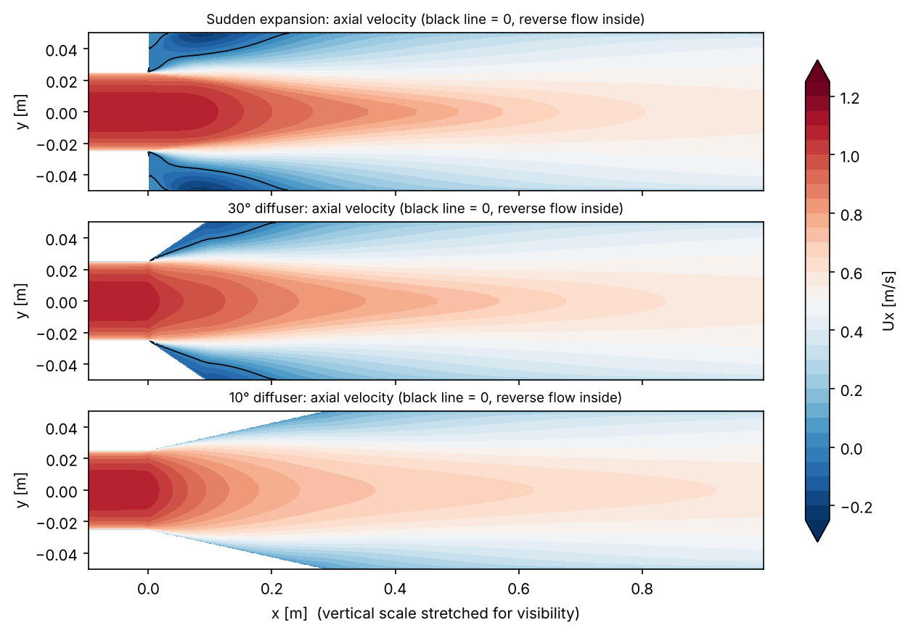
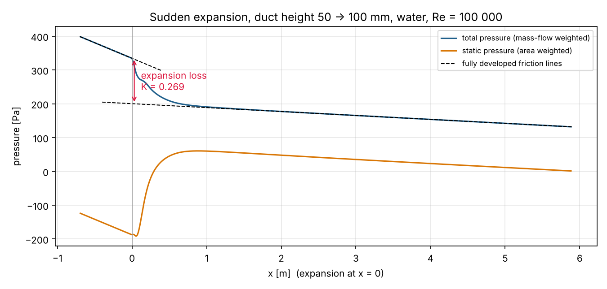
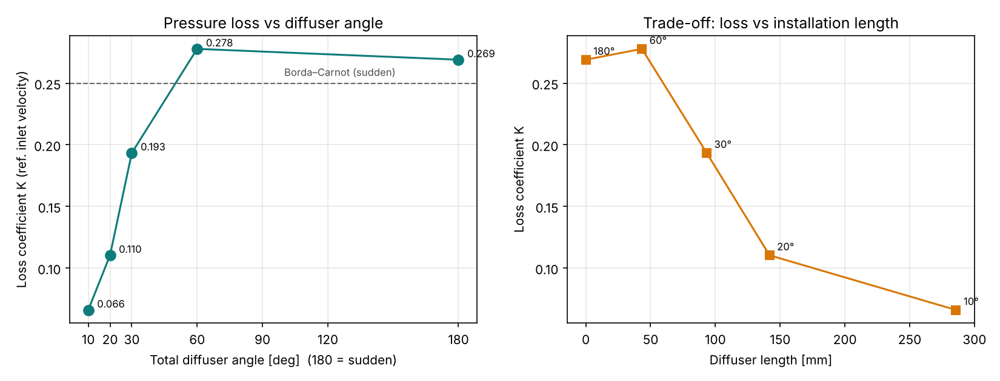

# Duct Expansion Pressure Loss: Sudden vs Diffuser (OpenFOAM CFD)

How much pressure does a flow lose when a duct suddenly doubles in height, and how much of that loss can a diffuser recover? This project answers both questions with RANS CFD in **OpenFOAM**, validates the model against classical correlations, and compares five expansion designs.

Built with **open-source tools** (OpenFOAM v2412, Python) so anyone can rerun it. A step-by-step guide for repeating the study in **ANSYS Fluent** is in [`ansys/ANSYS_Fluent_steps.md`](ansys/ANSYS_Fluent_steps.md).



## Problem

| | |
|---|---|
| Geometry | 2D duct, height 50 mm → 100 mm (area ratio 0.5). The upper half is modelled with a symmetry plane on the centreline |
| Fluid | Water, ν = 1.0 × 10⁻⁶ m²/s |
| Flow | Bulk velocity 1 m/s in the inlet duct, Re (hydraulic diameter) = 100 000, turbulent |
| Inlet | Fully developed. The profile is recycled from 8 duct heights downstream |
| Solver | `simpleFoam` (steady, incompressible), k-ω SST turbulence model, wall-resolved mesh (y⁺ ≈ 1) |
| Variants | Sudden expansion, and planar diffusers with total angles of 60°, 30°, 20° and 10° |

## Method

The loss coefficient **K** is found the same way as in a lab experiment. Total pressure is plotted along the duct, and straight lines are fitted to the fully developed regions far upstream and far downstream (which carry only wall friction). Both lines are extrapolated to the expansion, and the jump between them is the loss caused by the expansion alone:

K = Δp₀,loss / (½ ρ U₁²)



## Results

### 1. Validation

| Quantity | CFD | Reference | Difference |
|---|---|---|---|
| Friction factor, inlet duct | 0.0185 | 0.0195 (Dean correlation) | −5.5 % |
| Friction factor, outlet duct | 0.0187 | 0.0195 (Dean correlation) | −4.5 % |
| Sudden-expansion loss K | 0.269 | 0.250 (Borda–Carnot, uniform flow) | +7.6 % |
| Sudden-expansion loss K | 0.269 | 0.273 (Borda–Carnot with turbulent profile correction) | −1.2 % |

The model reproduces the friction factor within about 5 % and the sudden-expansion loss within about 1 % of theory.

### 2. Mesh independence (sudden expansion)

| Mesh | Cells | K | Recirculation length |
|---|---|---|---|
| Coarse | 13 248 | 0.2693 | 240 mm |
| Medium | 23 552 | 0.2692 | 239 mm |
| Fine (used) | 36 800 | 0.2691 | 239 mm |

K changes by less than 0.1 % between meshes, so the result does not depend on the mesh. The recirculation zone behind the step is about 9.6 step heights long.

### 3. Design variants



| Variant | Diffuser length | Loss coefficient K | vs sudden | Pressure recovery Cp (ideal 0.75) | Loss at 1 m/s (water) | Flow |
|---|---|---|---|---|---|---|
| Sudden expansion | 0 mm | 0.269 | — | 0.52 | 134 Pa | recirculation over ~240 mm |
| 60° diffuser | 43 mm | 0.278 | +3 % | 0.51 | 139 Pa | separates at the diffuser inlet |
| 30° diffuser | 93 mm | 0.193 | −28 % | 0.59 | 97 Pa | separated |
| 20° diffuser | 142 mm | 0.110 | −59 % | 0.68 | 55 Pa | small separation |
| **10° diffuser** | 286 mm | **0.066** | **−75 %** | **0.72** | **33 Pa** | **fully attached** |

**Findings**

- **A 10° diffuser cuts the expansion loss by 75 %** compared with a sudden expansion (K = 0.066 vs 0.269). It recovers 96 % of the ideal static-pressure rise, because the flow stays attached to the walls.
- **The angle matters more than having a diffuser at all.** A short 60° diffuser is *no better* than a sudden step (+3 %). The flow separates immediately and behaves like a step. Losses fall steeply only below about 30°.
- **There is a trade-off with length.** The 20° diffuser achieves about 80 % of the 10° saving in half the length (142 vs 286 mm). It is the better choice where space is limited, for example in compact ship piping or HVAC ducts.
- For a pumped system, the expansion loss is energy the pump has to supply continuously. Replacing a sudden expansion with a 10° diffuser saves about 100 Pa per fitting at 1 m/s, and the saving scales with velocity squared.

## Limitations

- 2D planar duct (a wide rectangular channel). An axisymmetric pipe or 3D duct would give different numbers, but the same trends.
- A symmetric flow is enforced by the centreline symmetry plane. Real symmetric sudden expansions can switch to an asymmetric flow pattern (the Coandă effect).
- Steady RANS (k-ω SST). Diffusers near stall are unsteady in reality, so the results for the 20–60° cases are approximate.

## Run it yourself

Needs OpenFOAM v2412 (Linux, WSL on Windows, or `conda install -c conda-forge openfoam`) and Python with numpy and matplotlib.

```bash
python scripts/run_cases.py      # builds and runs all 7 cases (about 1–2 h on 2 cores)
python scripts/analyse.py        # tables and plots in results/
```

## Project structure

```
src/case_builder.py    writes the OpenFOAM case (mesh, boundary conditions, solver settings) for any expansion angle
src/foam_io.py         reads OpenFOAM fields, computes mass-weighted total-pressure profiles
scripts/run_cases.py   runs the mesh study and the design variants
scripts/analyse.py     validation, loss coefficients, plots
results/               CSV tables and figures
ansys/                 how to repeat the study in ANSYS Fluent
```

---
Muhammad Maaz Asmat · Mechanical Engineer, M.Sc. student in Sustainable Maritime Operations (Hochschule Emden/Leer)
